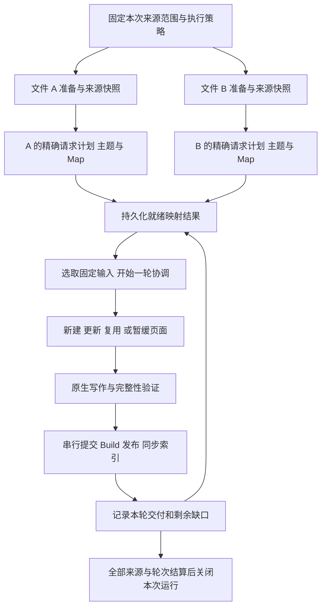

# 增量知识摄取架构设计与分阶段实施计划

日期：2026-11-17；实施更新：2026-11-18。状态：D0–D4 候选已部署并通过隔离验证；D5 原生流程验证尚未执行。

目标是边处理边交付：一份文件准备完成后即可开展主题与证据映射，合格知识页面可以提前发布；后续文件补充同一页面时产生新的页面版本。Vault 按明确的版本集合交付，保留失败来源、未完成覆盖和实际依赖的隔离记录。

本设计覆盖 Skills、共享运行库、持久化结构、原生执行、页面修订和发布索引。前端页面、节点显示、暂停与恢复控制由另一工作流负责；本文只规定双方需要对接的领域身份和准入接口。本文原为设计稿；2026-11-18 已按另行授权实施、同步并部署候选。该授权不恢复或启动任何测试流程。

## 1 设计范围与基本决定

1. 保留 Exact-plan、Pass／Map、Reduce、Finalize、Release & Provider sync 的业务含义，分别作用于来源、页面变更和交付轮次。五阶段不再表示全库只能处于一个阶段。
2. 继续使用 Hermes 原生 Kanban、worker 绑定、可信完成确认和现有资源限制。程序负责编排、证据绑定和验证；Hermes 原生工作者负责主题识别、映射、协调和写作。
3. 新模式显式固定为拟议的 `workflow_mode=incremental_v1`。旧工作流按原合同继续运行，不能从目录中出现了新文件推断模式或自动迁移。
4. Vault 的 `_system` 保存权威领域记录。Kanban 投影可以重建；Provider 索引、模型和缓存仍在 Provider 主机、Vault 外。首版不要求数据库迁移、消息中间件或新的通用调度框架。
5. 首版输入是一份固定来源清单。运行期间不静默吸收文件夹新增文件。后续上传或来源换版通过新的明确请求进入同一 Vault；不能以新请求掩盖旧运行的失败、消耗或暂停。
6. 同 Vault 首版只允许一个活跃增量协调轮次，独立来源 Map 和轮次内独立页面写作可并行。同一页面只允许一个活跃修订，同 Vault 的提交和发布有唯一执行者。
7. 本轮仍以合格知识页发布为检索交付范围，不增加原始 PDF 分块直接检索。索引就绪不自动开启 Query。
8. 首版允许发布更新期间出现短暂的检索不可用窗口。持续服务旧发布需要额外的版本读取设计，不计入首版承诺。

已有暂停、治理、来源资格、原文和资产完整性、原生凭据、预算、部分交付规则继续有效。来源 QA 仍作为原始标注保留；具体材料或内容失败阻断实际依赖。已知转换缺陷不因采用增量模式而重复触发模型纠正或重新转换。

## 2 当前实现与改造依据

代码核对基线为本地 `main` 的 `8cdd04a16d3b4a9a08723e75c22ccb697c687bfb`。该 SHA 用于定位设计依据，不表示已核验或部署 WSL 运行时。后续实施以当时已提交的前端控制接口为集成基线。

| 范围 | 现有能力 | 本次需要调整的边界 |
| --- | --- | --- |
| 来源准备 | 一来源一卡、转换监督、有效 UnitSet 复用、原生完成凭据 | 每个来源单独封存并准入下游，不等待整批来源交接 |
| 短路径来源交接 | 来源工作流在 `exact_plan` 或终态结算，绑定整份账本哈希 | 新合同绑定具体来源快照；执行权另行检查，不能只删除旧哈希校验 |
| 主题与 Map | 请求和回执可重放，主题提取可按来源生成 | `advance()` 的整批等待改为按来源推进，跨来源消费固定映射结果集合 |
| 页面身份与修订 | 通用 Build 有稳定 subject/page 身份、父版本和冲突检查 | 短路径 `short_build.projection()` 当前固定新建，需接通通用修订机制 |
| 发布 | 精确 Build 范围、部分交付、发布基线和来源撤回分析 | 多轮提交串行化，区分追加与替换撤回 |
| 检索 | 当前 release 与 generation 匹配、缓存与重建能力 | 识别交付窗口，拒绝混合页面和索引版本，恢复仅补未完成交付 |

实现定位：[五阶段约定](SHORT_PATH_STAGE_MODEL.md)、[来源交接](../hermes-obsidian-governed-ingest-orchestrator/scripts/run_short_evidence_test.py)、[请求规划](../hermes-obsidian-governed-ingest-orchestrator/scripts/prepare_short_evidence_test.py)、[短路径 Build](../hermes-source-units/src/hermes_source_units/short_build.py)、[通用知识构建](../hermes-source-units/src/hermes_source_units/knowledge_build.py)、[发布适配](../hermes-obsidian-governed-ingest-orchestrator/lib/short_formal_build.py)。

## 3 目标执行结构



### 3.1 来源层

来源完成的含义是：当前来源版本、转换产物和 UnitSet 已验证，原生任务完成已获可信确认，随后可封存快照。仅看到 Bundle 文件或任务退出不构成准入证据。封存 A 不需要等待 B 的工作者退出。

每个来源单独进行精确组包、主题提取和 Map；保留章节、条件、例外、上下文、必读资产及逐单元处置。失败或待处理材料不能从覆盖清单消失。

来源转换复用分支有时只返回 UnitSet manifest。封存程序应沿现有受控关系恢复并验证 artifact、Bundle 与原生准备记录，不因结果列表没有直接列出 Bundle 就重新转换。

### 3.2 页面层

协调器消费固定的一组已完成映射，参考已登记的页面身份、范围和版本，决定新建、更新、复用或暂缓。标题相同只是匹配线索；页面身份由现有 subject registry 管理，不能随本轮主题列表或文件顺序变化。

更新输入包括待修订的旧正文、新材料，以及仍支撑原有结论的必要旧原文和资产。旧正文不能替代原始证据。删除支持关系必须有明确的换版、撤回、错误隔离或纠正依据，不能作为模型精简正文的副作用。

每个页面版本记录自己的材料范围。尚未处理的文件保持未知；不能宣称它们没有相关内容。要求综合指定全部来源的页面，等待其明确依赖结算；已在限定范围内完整的页面可先交付。

### 3.3 轮次与 Vault 层

一个轮次固定消费若干就绪映射结果，生成有限的页面变更与交付清单。开始后不追加输入；新到材料进入下一轮。首份文件可以独立形成一轮，协调器空闲时同时收集其他已就绪结果，按现有请求和输出预算分包。

首版不引入自适应批量调参。采用确定性就绪顺序和固定上限；某项超出预算时保留原因，不能让它永久阻止后续独立项。一个轮次不因暂缓页面无限保持活跃，明确记录这些缺口后允许下一轮处理其他有效材料。

若一页刚生成时又有新证据到达，该证据只安排到后续轮次；同一已消费映射不重复触发相同更新。“已消费”只约束触发，不禁止后续页面修订引用旧 Map。A 的暂缓页面因 B 的新材料具备推进条件时，新轮次引用 A 的原回执并重新评估该页，不重做 A 的 Map 或重复计费。无变化或重复请求应产生复用处置，不调用模型。阶段预算和运行累计预算共同约束轮次，不能用创建新轮次刷新消耗。

## 4 持久化结构与身份

以下 `incremental-*` 名称、字段和路径均为拟新增合同。已有 SourceUnit、知识页修订和 release 继续引用原合同，不另建一套领域正文。

| 对象 | 核心字段 | 不变量 |
| --- | --- | --- |
| `incremental-run/v1` | `run_id`、Vault、actor、mode、固定来源全集、policy、contract 集合、revision、来源状态、轮次索引、预算引用、控制协议引用 | 来源全集与初始策略固定；revision 仅控制本记录并发更新 |
| `incremental-source-snapshot/v1` | `snapshot_id`、resource/document/version 身份、原件引用与 SHA、artifact 版本、UnitSet、Bundle 与资产清单哈希、内容合同 | 内容不可变；当前治理与执行许可另行复核 |
| `incremental-source-seal/v1` | seal ID、snapshot ID/hash、产生来源的原生完成凭据、封存者授权、验证结果、治理检查版本与操作 ID | 将内容身份与产生者、验证时点分离；封存和复用各有独立回执 |
| `incremental-map-result/v1` | `map_result_id`、snapshot、请求和别名表摘要、原生任务会话与完成回执、主题映射、覆盖处置、未解决项、预算账目引用 | 原始响应和失败历史保留；同内容重复提交返回同结果 |
| `incremental-round-input/v1` | `round_id`、run、选中 map IDs、相关 source snapshots、合同、预算预留、输入摘要 | 一经封存不追加；未选来源保留在运行索引中 |
| `incremental-page-change/v1` | change/round IDs、action、subject/page 身份、父版本与正文哈希、输入和覆盖范围、增删保留的证据、资产、未解决项、原生授权引用 | 每个 update 指定准确父版本；hold 只是一种规划处置 |
| `incremental-build-authorization/v1` | actor、run/round、控制许可、精确 page change 集合、写作回执摘要、来源快照和映射摘要、预算处置、base release、publish 与检索策略 | 授权固定候选和输入；不是对整个 Vault 的任意写入许可 |
| `incremental-round-delivery/v1` | delivery ID、base release ID/hash、Build IDs、精确页面修订、source changes、隔离及缺口、release ID/hash、Provider generation、步骤回执 | 同一轮重试沿用操作身份；发布和索引不混用版本 |
| `incremental-run-closure/v1` | 来源结算、所有轮次处置、覆盖与排除、最终 release/index 状态、累计调用与失败账目 | 不以队列暂时为空判断运行完成 |

### 4.1 指纹与短编号

`snapshot_id` 从规范序列化后的来源身份和内容版本计算，不包含时间、显示名称或全局工作流 revision。原生凭据、封存者和验证时点放在独立 seal 回执中，绑定 snapshot 的准确 ID/hash。同内容的不同可信尝试复用同一快照、追加各自回执，禁止同一个不可变 snapshot ID 对应不同 JSON。内容相同不代表调用方自动拥有读取或执行权。

语义请求身份绑定阶段、输入快照、真实材料范围、模板和合同、预算及页面父版本。与某项工作无关的来源完成，不改变其请求指纹。尝试 ID、工作者租约和重试序号单独记录。

`S1`、`S1-B2` 仅是一次不可变请求内部的短别名。回执保存 `alias → SourceUnit ref + content hash + snapshot` 的准确映射。跨轮次通过真实引用关联，不重编号、改写或重新解释旧响应。

### 4.2 页面变更示例

下面是拟议的字段示意，不是可提交给当前程序的请求：

```json
{
  "contract": "incremental-page-change/v1",
  "change_id": "change-002",
  "round_id": "round-002",
  "action": "update",
  "page_id": "existing-page-id",
  "subject_id": "existing-subject-id",
  "expected_parent_revision_id": "page-revision-001",
  "parent_authored_sha256": "<sha256>",
  "input_source_snapshots": ["snapshot-A", "snapshot-B"],
  "mapping_receipts": ["map-A", "map-B"],
  "retained_support_refs": ["<existing-UnitRef>"],
  "added_support_refs": ["<new-UnitRef>"],
  "removed_support_refs": [],
  "coverage_scope": {"basis": "declared_sources", "sources": ["A", "B"]},
  "required_assets": ["<asset-ref-and-hash>"],
  "unresolved": [],
  "budget_ref": "<reserved-budget-record>",
  "native_authorization_ref": "<bound-native-grant>"
}
```

计划动作 `create/update/reuse/hold` 由适配层映射到现有 Build 合同。`hold` 不作为 page revision 写入；不得直接扩展旧动作枚举并让旧读取器误解。

### 4.3 文件布局与提交

拟新增权威路径：

```text
_system/ledgers/incremental-ingest/<run-id>/run.json
_system/ledgers/incremental-ingest/<run-id>/rounds/<round-id>/input.json
_system/ledgers/incremental-ingest/<run-id>/rounds/<round-id>/page-changes.json
_system/ledgers/incremental-ingest/<run-id>/rounds/<round-id>/delivery.json
_system/ledgers/incremental-ingest/<run-id>/operations/<operation-id>.json
_system/reports/incremental-ingest/<run-id>/source-snapshots/<snapshot-id>.json
_system/reports/incremental-ingest/<run-id>/source-seals/<seal-id>.json
_system/reports/incremental-ingest/<run-id>/map-results/<map-result-id>.json
_system/reports/incremental-ingest/<run-id>/closure.json
_system/metadata/incremental-delivery-state.json
```

原件、Bundle、UnitSet、页面修订、release 使用现有存储位置，通过准确引用连接。新的决定性请求、响应与原生回执必须持久保留并可校验；运行索引不复制这些正文。历史 Vault 外回执仅可通过受控复用清单引用，路径缺失或无法验真时保持不可复用。

复用现有锁、原子写和 revision 检查。跨文件更新采用“先写不可变成果，再写操作回执并更新索引”的可恢复顺序；恢复时核对同一 operation 的成果，不凭进度文件补造完成事实。进程退出不释放业务暂停，也不能让旧工作者继续提交。

工作者提交自己的结果时核验当前原生 claim 和控制许可。来源快照封存与可信结算由协调器或原生程序任务执行，核验其自身当前授权，以及已经结束的来源任务的持久完成凭据；不能要求已完成的来源任务仍持有 live claim。历史语义结果复用同理，原执行凭据与本次复用授权分别核验。

## 5 领域状态与执行准入

来源、页面、轮次分别记录状态，避免一个单调递增的 `current_node` 表达整个增量运行。

| 对象 | 建议状态或处置 |
| --- | --- |
| 来源处理 | pending → preparing → prepared → mapping → mapped；失败或执行受阻另记原因 |
| 页面变更 | planned → writing → verified → committed；可处置为 reused 或 held |
| 轮次 | frozen → coordinating → writing → delivery → settled；缺口随 settled 保存 |
| 运行结果 | active、completed、partial；paused/cancelled 等控制状态来自统一控制接口 |
| 检索 | disabled、delivery_in_progress、index_pending、ready、blocked，并保留原因 |

只有来源领域失败才能记为来源失败；工作者权限、租约或运行错误仍是执行受阻。`mapped` 表示映射结果及覆盖处置已结算，不保证全部内容合格，也不等于知识页已交付。

执行准入需同时满足：来源和依赖有效、任务在固定范围内、原生授权有效、预算可用、控制层允许进入该作用域和阶段。替换整批来源账本哈希后，暂停、取消、claim、治理和模板检查必须继续独立成立。

当一个来源被替换、撤回或确认存在实质错误时，复用现有 SourceUnit 支持关系和直接依赖分析，阻断相关材料与页面。不能因快照曾有效就继续使用；也不因无关注册表 revision 递增而重算所有来源。原生绑定引用全局 revision 的位置应在新合同下显式重新验证或重绑定，不能在调用方忽略 `STALE_INPUT`。

## 6 拟新增接口与现有入口复用

### 6.1 外部入口

拟新增 Orchestrator 的 `scripts/manage_incremental_ingest.py`，作为薄 CLI 包装，共用领域服务。Skill 中始终以 `python3 "<skill-dir>/scripts/manage_incremental_ingest.py" ...` 调用。以下命令仅说明设计形状，当前不可执行：

| 操作 | 输入 | 行为和权限 |
| --- | --- | --- |
| `start --request <json>` | Vault 或 Bootstrap 请求、固定 sources、actor、mode、预算、已有控制策略 | 明确授权后创建新运行；稳定 operation ID 防止重复启动 |
| `status --run-id <id>` | run ID，必要时选择 source/round/page | 只读返回领域状态、证据引用和阻塞原因 |
| `reconcile --request <json>` | operation ID、run ID、expected revision、既有执行授权 | 从持久结果核对并补派获准的未完成工作；不释放暂停、不扩展预算 |
| `preview-reuse --request <json>` | 旧成果引用、目标来源/合同、请求范围 | 只读输出逐项复用判定与原因，不启动来源重置或新调用 |

`start_vault_workflow.py` 负责在新模式下选择共用入口并复用 Bootstrap。`start_post_mineru_short_test.py` 保持独立测试和旧合同入口，不作为新增量模式唯一的产品 API。模式路由只在首次创建时固定，旧命令默认行为不变。

暂停、继续、节点重进、观察超时和 HTTP routes 由另一工作流维护，本设计不另建这些命令。运行恢复仍调用统一控制服务；`reconcile` 不等于用户的“继续”。

### 6.2 内部服务接口

| 拟议接口 | 所属职责 | 必要检查与输出 |
| --- | --- | --- |
| `seal_source_snapshot(binding, outcome)` | 来源准入 | 本来源原生完成、原件/Bundle/UnitSet/资产与治理；输出不可变 snapshot 和独立 seal 回执 |
| `validate_source_snapshot(ref, purpose)` | 共享来源读取 | 内容和当前治理；返回 valid/held 及具体原因 |
| `plan_source_map(snapshot, contracts, budget)` | 原生请求规划 | 完整输入预算、稳定别名和模板；输出原生待办，不生成语义结果 |
| `commit_source_map(binding, result)` | 可信完成 | 精确请求、真实响应、回执、覆盖及消耗；幂等写入 map result |
| `freeze_round(run, revision, bounds)` | Vault 协调 | 选择未结算的就绪映射，写不可变 round input，防重复消费 |
| `plan_page_changes(round, registry_view)` | 原生协调 | 现有身份与父版本、新旧证据范围；输出新建/更新/复用/暂缓 |
| `prepare_page_revision(change)` | 程序组包 | 新旧必要原文、资产、覆盖和预算；提供原生写作输入 |
| `commit_round_build(delivery, native_receipts)` | 正式 Build | 通用父版本/正文哈希/claim 检查；返回精确修订和 Build 回执 |
| `deliver_round(delivery, authorization)` | 发布编排 | 现有 plan/apply/validate/sync，稳定操作 ID 与发布基线 |
| `recover_round_delivery(delivery, disposition, authorization)` | 交付机械恢复 | 检查提交前缀；支持继续、撤销未提交窗口、隔离已提交范围；复用原正文和回执，不产生新语义结果 |
| `close_run(run, revision)` | 原生程序收尾 | 来源、轮次、覆盖、交付、消耗及原生排空证据；输出 completed/partial |

这些接口不能成为 Codex 或验收脚本代写领域结果的入口。语义结果提交需要 Hermes 原生任务、会话、请求指纹和可信完成证据；机械验收只核验这些结果。

正式 Build 为新增量凭据提供明确的合同分支：使用 `incremental-build-authorization/v1` 绑定本轮候选、来源快照、父版本和原生写作回执，不能借用旧 `short-formal-authorization/v1` 并跳过其 origin/账本检查。既有原生 Build 凭据升级采用明确版本或独立 schema，由 Build、发布和读取方共同识别；旧凭据继续按原合同验证。

所有变更请求统一带 `operation_id`、目标身份和预期 revision。同键同内容返回原回执；同键异内容报冲突。原生 worker 另携带任务绑定。只读预览不隐含 mutation、发布或 Provider 同步授权。

### 6.3 与前端及暂停恢复的集成合同

领域层提供 `run_id`、`scope_kind`（run/source/round/page）、`scope_id`、`stage`、`input_fingerprint`、结果和原生占用摘要。统一控制层提供 `check_admission(scope, stage, input_fingerprint)` 的允许/拒绝判定及控制凭据；准确函数名由对接时确定。

全局暂停继续约束全部范围；新增局部控制必须显式声明范围。已有 `pause_after` 和停止指令保持原义，不能把整批暂停自动缩为只暂停当前轮次。恢复必须确认 scope 和输入未变，且不能通过新建轮次绕开暂停。

2026-11-17 的控制实现采用线性节点顺序。新增量模式不能直接把多个轮次塞进同一个线性进度对象。集成时应提供作用域适配，并保留旧模式投影；在适配能够拒绝越界执行之前，不启用新增量执行。这里不规定 UI 按钮或重新实现控制状态机。

## 7 页面版本与交付恢复

### 7.1 修订与冲突

通用 `knowledge_build.py` 已支持身份注册、父版本和提交冲突；扩展短路径适配接入该能力。除了 `projection()`，还须调整 `admit()` 中拒绝已有身份和路径的检查，按新合同区分 create/update，不能全局放宽旧保护。规划时记录父版本和正文哈希，提交时重新检查。若父版本已改变，保留写作回执并将该页记为冲突，重新判断受影响输入；不得修改父版本字段后直接重交旧正文。

已有短路径页的身份为注册表中的既有身份，新模式第一次更新时建立明确绑定，保留原 page ID、路径和父版本。主题集合变化或标题相同都不授权创建替代页、合并或改路径。

### 7.2 首版串行交付窗口

现有 Build 提交会写 canonical Markdown；Provider 从发布记录的路径读取并验证正文，且拒绝不匹配当前 release 的索引。因此仅增加父版本字段不能保证更新期间旧发布一直可读。

首版采用以下持久顺序：

```text
写作完成并验证 → delivery prepared
→ 取得 Vault 交付权并记录 query_ready=false
→ build_committing → build_committed
→ release_applying → release_applied
→ index_pending → index_verified
→ committed，并按原 Query 开关报告就绪
```

进入窗口前尽量完成所有只读预检、原生写作和输入验证，避免把模型等待放进窗口。`incremental-delivery-state.json` 记录 owner、操作身份、目标页/父版本、base release、步骤和回执。锁和原生授权防止并发提交；进程崩溃后该状态仍有效，所有受支持的 Query/Provider 读取入口均需识别窗口，不能仅靠前端显示禁用。

可恢复记录至少固定：控制凭据与 owner、base release ID/hash、预期身份注册表 revision、每页父版本/旧正文哈希/目标版本/新正文哈希、Build manifest 与保留正文引用、来源和原生回执指纹、提交前预检以及批准的交付/隔离范围。状态转换回执不可变，head 只指向最新有效回执。

现有 Build 可能在修订 sidecar、canonical 正文、身份注册表、任务记录、完成 manifest 之间中断。恢复必须校验这些实际写入的前缀与固定目标是否一致，不能仅凭 `build_committing` 重做全部步骤。接管者取得新的有效原生授权和控制准入；旧 owner 的进程锁消失不构成接管授权。

| 中断位置 | 恢复行为 |
| --- | --- |
| Build 尚未提交 | 核验写作和输入，复用回执；若中止且确认没有领域写入，可关闭窗口 |
| Build 提交中或已提交 | 使用同一 Build/修订记录核对实际提交位置；由支持的恢复入口完成剩余提交，不重复模型调用 |
| release apply 结果不明 | 根据固定 release/plan ID 读取已提交结果，验证后前进，不能生成新 ID 盲目重发 |
| 索引失败 | 保留已提交 release，恢复准确 release 的索引；不重写知识页 |
| 导航刷新失败 | 可选导航诊断保留，若不涉及实际必需链接，不撤销其他合格交付 |

交付故障采用有边界的退出策略。确认没有领域写入时可撤销窗口；存在部分提交时，默认执行一次获准的机械恢复，权限、证据或版本已变化则停止重试。提交完成但部分页面不可交付时，可在明确授权范围内向前隔离这些页面及直接依赖，形成有效的部分发布，保留其他合格成果；授权可以来自预先固定的交付策略，不能由错误发生本身推导。不能伪造完成的 Build 或手改 release 来完成隔离。

无法验证提交前缀或安全隔离时，状态保持受阻，报告准确影响与恢复缺口，检索不报告就绪；不自动回滚正文或重复模型调用。首版不保证所有故障下全库持续检索，但“安全撤销未提交窗口，或向前完成/隔离可验证的已提交范围”必须成为 D3 上线门槛。现有支持入口不足时，应在 D3 补齐通用恢复操作。

需要持续服务旧发布时，后续单独设计按 release 读取的接口及成对切换的服务版本指针。现有 `_system/knowledge-builds/<run-id>/pages/<page-id>.md` 已保留 Build 正文，`finalize_revision_state.content_path()` 可按 authored hash 选择原始或已登记修订正文；应优先复用这些对象，补齐 `page_revision → Build run → content ref` 的可验证解析，不另建正文版本库。Provider 当前仍从 canonical 路径读取，既有正文对象不等于已经支持旧发布持续服务。

### 7.3 追加与撤回

追加交付继续验证已有合格页面未被意外移除。来源替换/撤回复用现有 `source_changes`、支持关系和直接依赖分析，但采用独立的授权交付类型及准确影响清单。不能为了撤回而全局关闭追加保护，也不能为了保住旧页面而继续发布已失效内容。

只更新实际受影响页面。未变化页面的正文和 revision 应保持不变。Provider 可复用内容和模型指纹一致的缓存，但索引资格与新 release 的一致性必须重新验证。

## 8 现有成果复用与旧流程兼容

### 8.1 逐层复用判定

| 成果 | 可复用条件 | 不满足时 |
| --- | --- | --- |
| 原件、Bundle、UnitSet | 来源身份、当前版本、配置、哈希、资产与治理一致 | 记录具体失效，不自动重转换或重置来源 |
| 主题与 Map | 精确输入、别名表、合同、原生请求与完成回执可验证 | 仅复用能验证的低层成果；语义重执行需现有授权与预算 |
| 写作片段 | 新页面范围、父版本、新旧证据和覆盖职责仍适用 | 保留旧响应；仅对失效或新增职责安排获准工作 |
| 页面修订与 Build | 精确正文、支持、父版本、正式原生提交均有效 | 不从 Markdown 外观补造 Build 或验收凭据 |
| release 与索引 | release ID/hash、页面修订、资格、Provider 配置与模型指纹匹配 | 恢复交付或重建索引；不推导上游语义结果失效 |

已有历史合同的有效结果不因软件版本更新自动失效。复用判定写成新记录并引用原始凭据，不改写原响应、旧预算、错误记录或旧 acceptance。源操作和本次操作的消耗分别列出，跨运行报告去重；新 run/round 不能清零同一工作范围的累计重试限制。

原请求相同但调用结果未知时，保持未知状态并核查原生记录，不能按“没看到结果”直接重复调用。旧工作者崩溃但领域结果已验证且可信完成已确认时，可复用结果，只恢复观察或结算。

### 8.2 合同路由

新建增量运行显式固定 mode、输入快照合同、页面规划合同、控制协议和预算策略。旧运行继续使用其原图、来源 `exact_plan` 边界、哈希绑定、预算和恢复入口。新读取器支持按合同分派，缺少新字段的旧记录不能被推断成损坏的增量记录。

当前 `TestFrontend` 保留原运行身份与停止状态。本设计不把它转为新模式，不创建替代工作流，不释放任何暂停。将来复用其来源成果，需要明确选定范围并通过复用判定；对实际未达暂停点的流程也不能伪造暂停回执。

旧短路径测试 Bundle import 的约束继续有效。新的语义成果复用不能借用原来 `semantic_results_imported=False` 的测试入口绕过验证。

旧流程不会被迁移到新调度层。历史恢复和读取兼容应有明确回归样本；旧契约实现可逐步封装隔离，不开发通用旧任务合并或自动迁移框架。

## 9 需要修改的 Skills 与文件

以下均为未来实施范围，本设计不改动这些文件。

| Skill 或模块 | 计划修改 |
| --- | --- |
| `hermes-obsidian-vault-bootstrap` | `SKILL.md`、初始化目录/模板及 `scripts/init_obsidian_vault.py` 的新模式支持；只初始化结构，不进行转换或覆盖已有 Vault |
| `hermes-obsidian-controlled-ingest` | `SKILL.md`、来源/Build 参考文档；复用 `manage_source_units.py`、`manage_knowledge_build.py`；受控来源快照与修订组包；`lib/ingest_kanban.py` 的新图分支和准入绑定 |
| `hermes-obsidian-governed-ingest-orchestrator` | `SKILL.md`、`references/vault-startup.md`、`references/short-evidence-test.md`；新增薄管理入口与来源/轮次服务；调整 `lib/source_preparation.py`、`lib/short_evidence_pass.py`、`lib/short_formal_build.py`，抽取 `prepare_short_evidence_test.py` 和 `run_short_evidence_test.py` 的可复用规划/执行逻辑 |
| `hermes-obsidian-knowledge-finalize` | `SKILL.md`、发布和索引说明；扩展交付窗口、追加/撤回范围和恢复；复用 `scripts/manage_vault_finalize.py` 的 plan/apply/validate 与唯一 Skill 索引写入口 `scripts/sync_release_index.py` |
| `hermes-obsidian-controlled-query` | 识别正在交付和索引不匹配，保持查询只读；不因不可用自动同步、不自行开启 Query |
| `hermes-obsidian-vault-lint` | 增量合同的来源/回执引用、父版本、轮次、覆盖、交付状态一致性检查；旧合同使用旧验证规则 |
| canonical 共享库 | `hermes-source-units/src/hermes_source_units/schemas/contracts.json`、`interfaces.py`；拟新增来源快照和增量运行服务；调整 `ingest_workflow.py`、`short_build.py`、必要的 Build 验收、治理、scoped release 与查询读取逻辑 |
| Provider | `qmd-like-rag/src/qmd_like_rag/runtime.py` 和相关读取/状态入口识别交付窗口；核验 corpus/indexer 对新修订证据的支持，只有存在接口差异时改动，保留 generation 与 cache 合同 |
| 共享文档 | 本设计、五阶段约定、操作手册及 Skills 参考文档，明确新模式、恢复、版本与验收；运行结果另存报告 |

共享实现先修改 canonical 库，通过 `hermes-source-units/tools/sync_skill_runtime.py` 同步六个 Skills 和 Provider 内嵌副本。该工具还同步 controlled-ingest 的 Kanban 等适配器到 Orchestrator；不能在生成副本上独立修补。新增/修改 Skill 可执行脚本保留 shebang 和 Git `100755`，Skill 示例显式使用 `python3`。

前端、HTTP 控制、`short_operator_control.py` 及启动器控制逻辑由另一工作流负责。双方共享文件的集成先基于已提交接口确定改动归属，不覆盖对方未提交内容。这里提出的作用域数据是集成要求，不能视为另一工作流已经实现。

## 10 分阶段实施计划

阶段按依赖推进，不给出未经测量的工期。每阶段形成可审阅提交、受影响合同清单和验收记录。阶段通过仅证明其范围，不表示新模式已完成端到端交付。

| 阶段 | 实施内容 | 验收条件与交付边界 |
| --- | --- | --- |
| D0 合同与集成基线 | 固定 schema、ID、模式路由、来源/页面/轮次作用域；确认另一工作流控制接口；确认交付恢复现有入口 | 新旧合同路由明确；所有原生准入检查有归属；半提交恢复方案可实现；此阶段不启用新模式 |
| D1 来源独立推进 | 来源快照、稳定别名、逐来源主题/Map、累计预算与结果索引；保留旧来源交接 | A 在 B 转换时完成 Map；B 结算不使 A 失效；重启复用 A；实际撤回/篡改仍阻断；尚无提前 Wiki 交付 |
| D2 页面增量修订 | 固定轮次输入、稳定页面匹配、新旧证据组包、短路径 update 接通通用父版本提交 | A 产生 P1，B 在同一 page ID 上产生 P2；保留必要条件/资产；同名异范围不误合并；过期父版本拒绝。仅在隔离范围验证，未完成 D3 不启用真实增量发布 |
| D3 多轮交付 | 持久交付窗口、Build/发布/索引串行化、崩溃恢复与安全退出、Query 不就绪原因、导航合并刷新 | 第一份来源提前产生合格交付；下一轮更新后无混合版本；每个交付边界可恢复、撤销未提交窗口或获准向前隔离，且不重复模型调用；未修改页面保持原版。此阶段首次具备完整目标能力 |
| D4 覆盖收尾与兼容 | 跨来源综合页、显式来源替换/撤回、有限运行结算、历史复用适配、旧合同回归 | 7 就绪/1 失败保留准确缺口；实际依赖隔离；没有就绪任务也不会误报完成；旧流程和原始回执不变；旧模式恢复继续可用 |
| D5 独立原生验收与默认模式决策 | 在获准的新测试 Vault 完成真实文件到多轮发布；记录时延、成本、覆盖和恢复；再决定推广范围 | 达到下节矩阵；无新全量重跑要求；默认模式切换、发布和 Provider 同步分别按实际授权执行 |

各实施阶段沿用工作区次序：在 `main` 修改并提交，记录完整候选 SHA；获准部署时先验证旧版本远程可恢复、保存 host-only 变更、停止代码消费者并隔离其他运行，再部署候选，执行最小受影响范围验证。不增加独立的部署前全套回归，不在活跃 worker 下替换代码。

契约负例和故障注入放在隔离环境；真实语义验收由 Hermes 原生工作者完成。已有有效来源、Map、写作和 Build 在身份/哈希/合同检查后复用，只补缺失或失效工作。部署不授权启动、重试、越过暂停、发布或 Provider 同步。

本轮不推送或合并分支。未来获准进行分支维护时遵守 `main` 提交验证后在干净同一工作树 merge 到 `intranet` 的规则，保留内网部署配置；不创建额外分支或旧代码备份。运行结果与候选部署元数据单独记录。

## 11 验收矩阵与度量

| 场景 | 需要证明的结果 | 主要阶段 |
| --- | --- | --- |
| A 快、B 慢 | A 在 B 未完成时进入 Map，并在完整实现后提前交付页面；实际资源限制不被绕过 | D1、D3 |
| A、B 支撑同页 | 页面 ID 不变，P2 父版本为 P1；新旧必要证据、条件和例外保留 | D2 |
| 同名但范围不同 | 协调保留独立身份或待解决处置，不按标题合并 | D2 |
| 重复回执与重启 | 同请求幂等；已完成语义工作不重发；未知消耗不变成零 | D1 至 D4 |
| 一份转换失败 | 其他合格结果推进，失败来源和依赖缺口仍在 closure；不自动重转换 | D4 |
| 父版本或发布基线变化 | 拒绝过期提交，仅重新评估受影响范围；不直接换基线重交 | D2、D3 |
| Build/发布/索引边界崩溃 | 持久交付位置可核验，恢复仅补未完成步骤，Query 不返回混合版本 | D3 |
| 来源替换/撤回 | 受影响页与直接依赖正确隔离；其他页不重写；追加保护不被全局关闭 | D4 |
| 暂停、取消与延迟回执 | 所有 scope 尊重统一控制；重启或新轮次不能越过控制；旧租约不能提交 | D0 至 D4 |
| 旧流程与旧页面 | 历史字节和固定合同保留；显式选择旧页修订时才进入新父版本链 | D4 |
| 固定八份来源结束 | 每份来源和每项已知变更有处置；发布和索引一致，完整或部分完成结论准确 | D5 |

优先扩展现有 `test_source_unit_contracts.py`、`test_source_unit_runtime.py`、`test_short_evidence_path.py`、`test_short_formal_build.py`、`test_short_content_recovery.py`、`test_release_program.py`、`test_retrieval_provider.py` 和 `test_skill_packaging.py`；新增增量专属测试覆盖新合同，不复制已验证的旧实现。控制集成测试与另一工作流协作。只因接口或格式变化，不重复既有八切片语义 canary。

真实验收记录首个合格页面发布时间、首个索引就绪时间、整批结算时间、每页修订次数、每轮模型输入输出和实际消耗、复用次数、交付窗口时长、失败隔离与未覆盖量。比较范围和来源质量相同的数据，不能单凭页面数或更早出结果判断改造成功。

资源上限继续来自当前运行配置：不因为文件增量化而乘以文件数，也不从历史文档恢复旧的并发限制。MinerU 与 Provider 的资源争用先由已有准入和观测处理，不在首版引入自动调参或任务重排框架。

## 12 后续扩展边界

首版默认采用固定来源清单、确定性轮次选择、单 Vault 一个协调与交付通道、已有页面检索范围、短暂交付窗口。批次上限属于显式配置，依据实测再调整，不影响来源身份或页面含义。

以下能力单独评估：持续接收无限文件流、更新全过程旧版本可查询、原始文档直接检索、数据库存储迁移、多个 Vault 的公平调度、自动批量调参及旧任务通用迁移。它们不应成为实现本次边处理边交付目标的前置依赖。


## 2026-11-18 实施接口与验收边界

- 显式 `workflow_mode=incremental_v1` 使用独立运行、来源快照、Map、固定轮次、页面变更和交付合同。旧工作流不迁移；前端默认仍为原整批短路径。
- 原生来源准备不再等待全批交接。快照封存及当前资格复验后，独立来源可执行主题和证据 Map；轮次最多消费 `max_maps_per_round` 个新映射，并绑定有界历史上下文。
- 协调区分 create/update/reuse/hold；页面更新固定 page ID、路径和准确父版本，同时保留旧证据及条件。写作、正式 Build 均保留 Hermes 原生任务凭据。
- Build 前打开串行交付窗口，发布与 Provider 索引绑定准确 release/hash。窗口内 Query 拒绝读取；恢复只补原交付未完成的前缀，不重新写作，不自动启用 Query。
- 控制入口为 `python3 "<skill-dir>/scripts/manage_incremental_ingest.py" --vault "<vault>" <action>`，支持 start/status/watch/control/reconcile/preview-reuse/recover-delivery。start 使用 `--request`、`--record`、`--bootstrap-skill`；status/watch 使用 `--run-id`；其余操作使用 `--request`。
- 暂停边界为 prepare、mapping、coordination、writing、formal-build、release、acceptance、closure。暂停先停止新准入并排空在途任务；继续必须绑定当前控制修订和准确 boundary fingerprint。启动器退出后可 reconcile 同一 run；未知模型消耗不清零。
- 前端显式增量选项提供固定预算、每轮来源数、暂停边界，以及来源/轮次/交付窗口投影。DevTools 展示协调器日志。
- D5 仍需用户授权的新独立原生流程验证：A 先就绪提前交付、B 后补同页、失败隔离、暂停接管与交付恢复。隔离回归不等同于原生全流程验收。本次不得恢复 TestFrontend 或其他工作流。

部署后验证：49 项隔离回归通过；写作绑定、暂停竞态与后台轮次推进补充修改后，15 项受影响检查通过。intranet 的 8 项部署配置检查通过，6 份受保护配置不变。前端与 Gateway 重启前确认 37 个原生看板无可派发任务。上述检查不替代 D5，且未恢复 TestFrontend。部署指纹和验证记录位于工作区 `tmp/incremental-ingest-20261118`。
